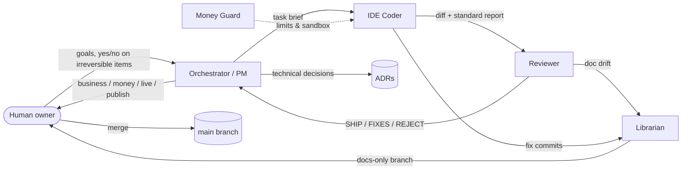

# Safe AI Agent Team Kit

**Drop-in `AGENTS.md` role templates that keep AI coding agents away from live systems, secrets and made-up claims.**

[](LICENSE) · Works with Cursor · Claude Code · Codex · Gemini CLI · anything that reads `AGENTS.md`

## Why
AI agents are fast. Near production, payments or trading infrastructure, fast is also how things break. An agent restarts the live service instead of the copy, trusts a stale comment over the code, "fixes" a red test by skipping it, or ends up reading a `.env`. Most of these failures come from the process, and a model upgrade won't fix them.

This kit is a set of plain-Markdown rules, built and battle-tested on real multi-agent projects over many months:
- **DRY_RUN by default.** No agent switches anything to live.
- **Nothing irreversible without a human yes:** push, publish, merge, money and deletion.
- **Secrets are untouchable.** If an agent finds one, it reports the path and type only.
- **Code is the source of truth.** Claims need `file:line` evidence.
- **Agents archive files and never delete them.** Failing tests are never bypassed.
- **Every task ends in the same report format**, so you can review it in a minute.
- **Clear escalation.** Technical questions get an ADR, and only business, money and irreversible items reach you.

See [`docs/WAR_STORIES.md`](docs/WAR_STORIES.md) for the incidents these rules came from.

## What's inside
| File | Role | Use when |
| :--- | :--- | :--- |
| [`roles/00_TEAM_CHARTER.md`](roles/00_TEAM_CHARTER.md) | Shared hard rules, rule hierarchy, kill switch, report format | Always |
| [`roles/01_IDE_CODER.md`](roles/01_IDE_CODER.md) | Coding agent with quality gates / Definition of Done | Always |
| [`roles/02_LIBRARIAN.md`](roles/02_LIBRARIAN.md) | Keeps docs true to code: may only edit docs/comments, checks comment edits leave the syntax tree unchanged, keeps the incident log | Docs keep drifting |
| [`roles/03_ORCHESTRATOR_PM.md`](roles/03_ORCHESTRATOR_PM.md) | Plans phases, briefs agents, decides technical questions | 2+ agents |
| [`roles/04_REVIEWER.md`](roles/04_REVIEWER.md) | Review order + SHIP / SHIP WITH FIXES / REJECT | Before every merge |
| [`roles/05_MONEY_GUARD.md`](roles/05_MONEY_GUARD.md) | Rules for payments, billing, wallets, trading, spend | Anything with money |
| [`roles/06_ESCALATION_ADR.md`](roles/06_ESCALATION_ADR.md) | When an agent decides itself and when it asks the human, plus the ADR template | Always |
| [`roles/07_CLEANUP_CARTOGRAPHER.md`](roles/07_CLEANUP_CARTOGRAPHER.md) | Inventory/tidy a legacy repo, zero behaviour change | Inherited mess |
| [`templates/`](templates/) | `INCIDENTS.md`, `OPEN_QUESTIONS.md`, folder `AGENTS.md` | Drop into `docs/` |

Project specifics are `{{PLACEHOLDERS}}`. List them with:
```bash
grep -rnoE "\{\{[^}]+\}\}" roles templates | sort -u
```

## Quick start
1. Copy `roles/00_TEAM_CHARTER.md` to your repo root as `TEAM_CHARTER.md` and `roles/06_ESCALATION_ADR.md` as `ESCALATION_ADR.md`. Then copy `templates/*` into `docs/`.
2. Fill in the placeholders.
3. Wire the files into your tool:

**Cursor:** use `roles/01_IDE_CODER.md` as root `AGENTS.md`, or as `.cursor/rules/coder.mdc` with `alwaysApply: true`. Open other roles in separate chats ("Act per `roles/04_REVIEWER.md`").

**Claude Code:** add a `CLAUDE.md` with
```
@TEAM_CHARTER.md
@AGENTS.md
```
Then put the other roles in `.claude/agents/<role>.md`, adding the `name`/`description` frontmatter.

**Codex:** Codex reads `AGENTS.md` at the root and in nested folders. Use the coder role at the root, starting with "Read TEAM_CHARTER.md first", and add folder files from `templates/FOLDER_AGENTS.md`.

**Gemini CLI:** put the same content in `GEMINI.md`, or point Gemini CLI's context file setting at `AGENTS.md`.

4. Enforce what you can outside the prompt: a pre-commit secret scan, a CI grep for forbidden IDs and references to the original/live system, coverage gates, and branch protection.

## How the roles work together


## Honest limits
- These are instructions. Models can still ignore them, so the kit lowers risk but can't remove it.
- Keep real credentials out of agent reach and keep the human approval step real.
- The kit deliberately leaves out stack-specific style rules. Use it alongside your own.
- Nothing here is financial, legal or tax advice.

## Contributing
New roles, tool-specific setups and war stories are welcome. See [CONTRIBUTING.md](CONTRIBUTING.md).
